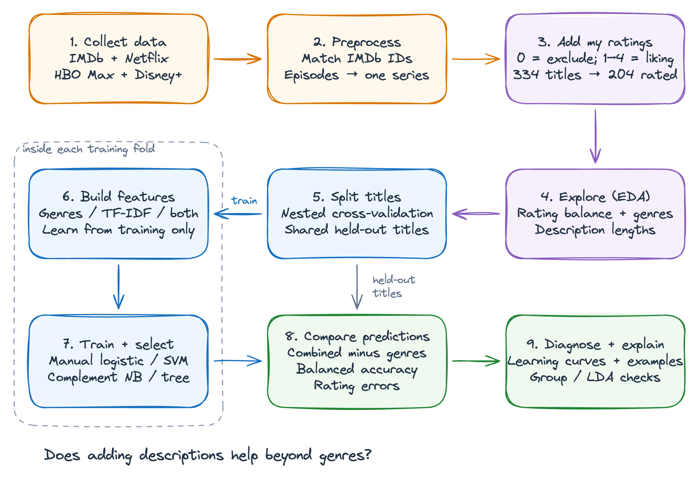

# CS156 — Machine Learning

## Can descriptions predict my enjoyment beyond genres?

This study compares genre labels with IMDb descriptions for predicting my liking of movies and series. It uses 204 rated titles and compares manual logistic regression, linear SVM, Complement Naive Bayes and a decision tree.



- [Executed notebook](first_pipeline/notebooks/first_pipeline.ipynb): preprocessing, EDA, model selection, evaluation and outputs.
- [LaTeX report](first_pipeline/report/first_pipeline.tex): explanations, figures and interpretation.
- [Supporting code](first_pipeline/src): preprocessing helpers, manual learner and experiment functions.

## Data

`first_pipeline/data/raw/` contains the IMDb exports, Netflix viewing history, HBO/Disney list captures, collected IMDb descriptions, reviewed title matches and completed rating workbook. `data/processed/` contains the final metadata, explicit ratings and modeling dataset. A rating of 0 excludes an unstarted title; 1–4 indicate increasing liking. One film or whole series is one observation. `config/` contains the fixed evaluation folds and model-selection settings.

## Run

Use Python 3.12. The notebook already includes all outputs; running it regenerates the analysis and figures.

```sh
cd first_pipeline
python3.12 -m venv .venv
.venv/bin/python -m pip install -r requirements.lock.txt
.venv/bin/python -m ipykernel install --prefix .venv --name cs156 --display-name "CS156 pipeline"
.venv/bin/python src/execute_notebook.py
```

## Result

Combined features average 34.16% balanced accuracy versus 33.62% for genres alone. The 0.53-percentage-point gain changes sign across partitions, so it does not establish a dependable improvement from descriptions.
